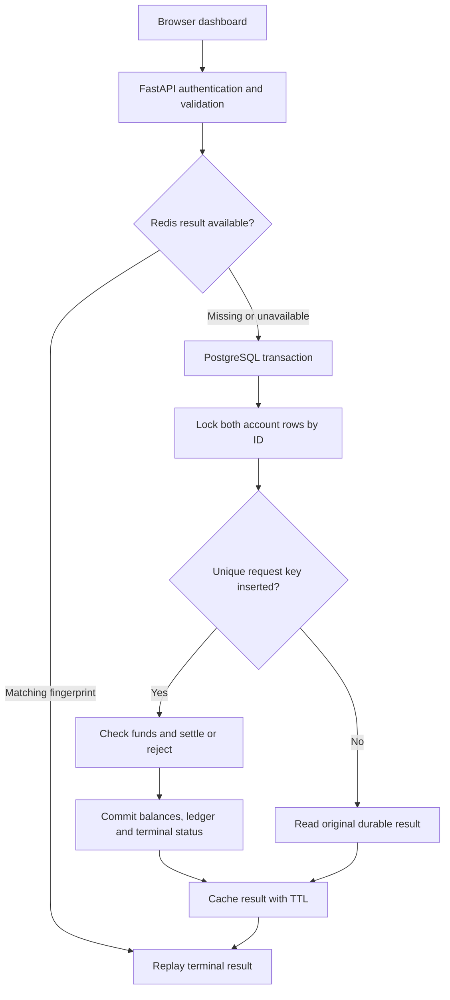
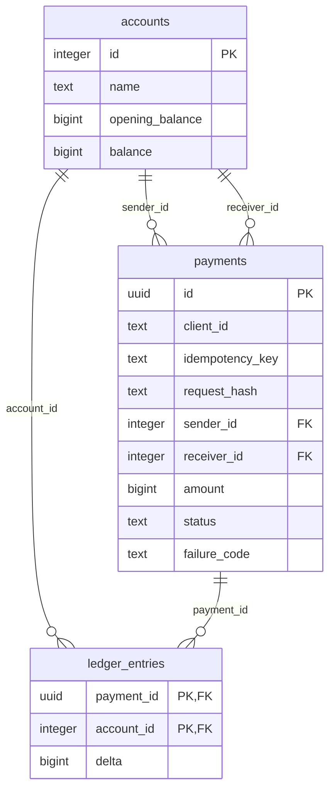

# Architecture and correctness argument

## Problem-to-implementation mapping

| Slide 2 problem | Implementation | Proof to demonstrate |
|---|---|---|
| Duplicate payments | Redis terminal-result cache, canonical request hash, permanent unique database key | Same key returns same UUID, one debit and two ledger entries |
| Wrong balances under concurrency | PostgreSQL `SELECT ... ORDER BY id FOR UPDATE`, integer money, balance check and all writes in one transaction | 100 unique transfers preserve exact balances; overspending never goes negative |
| Unknown outcome after failure | Atomic settlement, durable terminal result, status lookup and original-key retry | Timeout and actual crash before/after commit lead to one final settlement |

## Components

The browser calls a same-origin FastAPI service. The service uses a bounded psycopg pool to reach PostgreSQL and a short-timeout redis-py connection for cached results. There is no external banking side effect, message queue or background worker. The frontend is complete HTML/CSS/JavaScript served by FastAPI, so there is no separate frontend dependency chain.

## Transaction boundary

1. Validate strict request fields, authentication and key syntax before money changes.
2. Try Redis. A completed response with a matching fingerprint can replay immediately. Different fields return 409.
3. Begin a database transaction at PostgreSQL's default READ COMMITTED isolation.
4. Lock sender and receiver rows together, sorted by account ID. The funds check uses the locked, latest committed sender balance. Opposite-direction transfers acquire locks in the same order.
5. Attempt a unique payment insert. For an existing key, compare the hash and replay the existing terminal row. Uniqueness is permanent, independent of Redis's TTL.
6. For insufficient funds, commit a FAILED payment and no ledger entries. Otherwise debit, credit, append one negative and one positive ledger entry, and change the payment to SUCCEEDED.
7. Deferred database validation rejects a nonterminal payment or an incorrect success ledger at commit. The terminal-payment guard rejects edits to completed payments.
8. Commit before caching or returning success. Redis writes are best effort. Any database/response ambiguity calls for retry with the original key.

The unique insert and all monetary writes belong to the **same** transaction. PROCESSING exists only inside that uncommitted transaction. Other readers see either no payment or a terminal payment. This deliberately avoids abandoned durable PROCESSING rows and a recovery worker. A business rejection is a durable terminal FAILED result; an interrupted uncommitted attempt has no durable payment row.

## Database model

Money is integer paise. Accounts have nonnegative opening and current balances. Payments require different accounts, positive bounded amount, INR and valid state/timestamps. The composite ledger primary key permits one entry per account per payment. Foreign keys prevent orphan records.

The audit runs at REPEATABLE READ with one consistent snapshot. It checks `balance = opening_balance + sum(ledger.delta)` per account, conserved total money, two zero-sum entries per success, no entries for rejected payments, and no committed PROCESSING records. Audit does not repair data. Database-owner manual edits are outside the application's authorization boundary and can be detected by audit; this is not an independently tamper-proof accounting system.

## Failure matrix

| Failure point | Database state | Safe recovery |
|---|---|---|
| Before transaction | No change | Retry same key |
| After debit, before commit | Entire transaction rolls back | Retry same key creates one settlement |
| Database connection lost during commit | Caller cannot know yet | Query and retry same key |
| After commit, before cache | Terminal payment + balances durable | Database replay repopulates cache |
| After commit, response lost | Terminal payment durable | Retry returns original result |
| Redis expired or down | Database unchanged | Permanent unique key still prevents duplication |
| Insufficient funds | FAILED row, balances unchanged | Same key replays original rejection |

## Security and limits

Parameterized SQL, strict input types, operator-token authentication, same-origin fetch, CSP, no externally loaded application assets, and private environment secrets protect this local sandbox. Default host bindings are loopback. There are no real cards, bank accounts or payment credentials. Demo fault headers are gated by environment flags.

This implementation guarantees at most one committed internal settlement per operator/key while durable PostgreSQL records remain intact. It does not promise exactly-once HTTP delivery, deduplicate different keys for the same business purchase, or settle across an external bank. A production service would additionally need customer/merchant authorization, TLS, rate limits, managed secrets, least-privilege migration/runtime roles, tamper-resistant logs, backups and disaster recovery. Local PostgreSQL fsync and synchronous commit remain enabled, but no replicated failover or power-loss experiment is claimed. A bounded local concurrency run does not establish production scalability.
